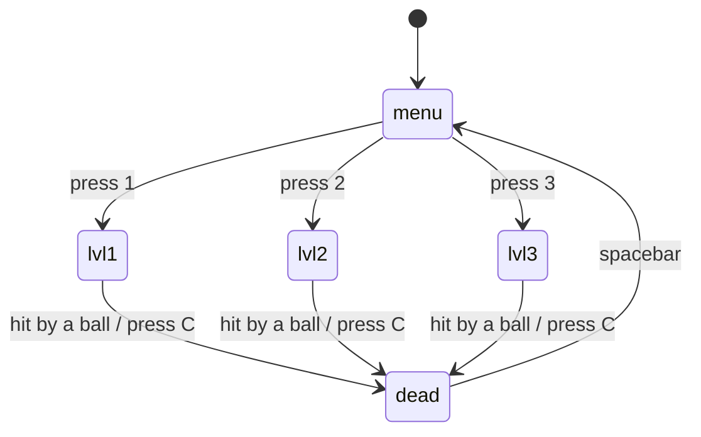

# Bouncing Orbs

## About the Game

Bouncing Orbs is a simple survival game made with p5.js.

The player controls a small circle and has to avoid the moving balls.

During the game, more balls can spawn. This makes the game harder the longer you survive.

There are three different levels. The harder levels have more abilities and other effects.

The game also has background music and sound effects.

---

## How to Run

1. Download or clone this repository.
2. Start a local server in the project folder (for example with the Live Server extension in VS Code). The game loads sound files, so it can fail when you open `index.html` directly.
3. Open `index.html` in your browser.
4. Press 1, 2 or 3 in the menu to start a level.

---

## Controls

The player moves using WASD.

* W = move up
* A = move left
* S = move down
* D = move right

Other controls:

* C = reset the balls / end the current game
* V = change the colors of the balls
* Mouse click = shoot a laser (only when the Spaceship ability is active)
* Spacebar = return to the menu after dying

From the main menu:

* 1 = Level 1
* 2 = Level 2
* 3 = Level 3

---

## Game States

The game uses different states to decide which screen or level should be shown.

The states are:

* `menu`
* `lvl1`
* `lvl2`
* `lvl3`
* `dead`

The current state is stored inside:

```js
let gameState = "menu";
```

This diagram shows how the game moves from one state to another:



When the game starts, the player first sees the main menu. The player can then choose one of the three levels.

When the player gets hit by a ball, the state changes to `"dead"`. This shows the death screen.

---

## Levels

### Level 1

Level 1 is the easiest level. The player has to survive the moving balls without the extra abilities.

### Level 2

Level 2 has random abilities. Balls also spawn faster than in Level 1.

### Level 3

Level 3 is the hardest level. It has random abilities, faster ball spawning and a black hole.

The screen can also shake when the Shake Screen ability is active.

---

## Player

The player is shown as a small circle.

The position of the player is stored with `playerX` and `playerY`. The movement speed is stored inside `playerSpeed`.

The player moves by changing `playerX` and `playerY`. For example, moving right increases `playerX`.

---

## Balls

All balls are stored inside the `balls` array.

Every ball has its own properties:

* X position
* Y position
* Size
* Red, green and blue color value
* X speed
* Y speed

New balls are created with `spawnBall()`.

The balls automatically move around the canvas. Their position changes using:

```js
ball.x += ball.speedX;
ball.y += ball.speedY;
```

---

## Wall Collision

The balls bounce against the edges of the canvas.

First, I calculate the radius of the ball. Then I calculate where every side of the ball is.

For example:

```text
right side = ball X + radius
left side = ball X - radius
```

When a ball touches the left or right wall, the X speed is reversed. When a ball touches the top or bottom wall, the Y speed is reversed.

This makes the ball bounce back into the canvas.

---

## Player Collision

The game checks if the player touches one of the balls.

To do this, I calculate the distance between the center of the player and the center of the ball. I use the Pythagoras distance formula:

```text
distance = √(distanceX² + distanceY²)
```

First I calculate:

```text
distanceX = playerX - ballX
distanceY = playerY - ballY
```

Then I calculate the real distance between them.

If the distance is smaller than the radius of both circles added together, the circles are touching.

```text
distance <= playerRadius + ballRadius
```

When the player touches a ball, the game ends.

---

## Ball-to-Ball Collision

The balls can also collide with each other.

The game compares the balls inside the array. For every two balls I calculate the distance between them. I again use:

```text
distance = √(distanceX² + distanceY²)
```

If their distance is smaller than both radiuses added together, they are touching.

When this happens, their X and Y speeds are reversed. This makes it look like the balls bounce away from each other.

---

## Timer

The timer keeps track of how long the player survives.

When a level starts, I save the current time using `millis()`. The starting time is stored inside `startTime`.

I calculate the timer using the difference between the current time and the starting time. The result is divided by 1000 because `millis()` works with milliseconds.

When the player dies, the final survival time is saved and shown on the death screen.

---

## Ball Spawning

New balls can automatically spawn while playing.

A random number is used to decide if a new ball should appear. The harder levels use a lower `ballSpawnRate`, which causes balls to spawn more often.

In Level 2 the game uses a spawn rate of 5. In Level 3 the game uses a spawn rate of 3, so new balls have a bigger chance to appear every second.

This makes the game harder while the player is surviving.

---

## Abilities

Level 2 and Level 3 can activate random abilities.

The function `createRandomAbility()` selects one random ability.

Only one ability can be active at the same time using `abilityActive`.

Most abilities stay active for 5 seconds. The random ability list also includes the Black Hole and Spaceship abilities.

### Speed Boost

The Speed Boost increases the player's movement speed.

The normal speed is 5. During the ability the speed becomes 10. After 5 seconds, the speed goes back to normal.

### Shrink Player

The Shrink Player ability makes the player smaller.

Because the player is smaller, it becomes easier to avoid the balls. After 5 seconds, the player returns to its normal size.

### Shake Screen

The Shake Screen ability shakes the whole game screen.

I do this by randomly moving the canvas a few pixels using `translate()`. After 5 seconds the shaking stops.

### Ghost Mode

Ghost Mode temporarily disables the collision between the player and the balls.

While Ghost Mode is active, the player's color also changes. After 5 seconds the player can be hit again.

### Giant Player

The Giant Player ability makes the player much bigger.

This makes avoiding the balls more difficult. After 5 seconds, the player returns to its normal size.

---

## Spaceship and Laser

The game also has a Spaceship ability.

When this ability becomes active, a launcher appears on the screen. The launcher is drawn with `createLauncher()`.

The player can then click somewhere on the canvas to shoot a laser in the direction of the mouse.

### Laser Direction

First I calculate the difference between the mouse position and the starting position of the laser:

```text
differenceX = mouseX - laserX
differenceY = mouseY - laserY
```

Then I calculate the distance using Pythagoras:

```text
distance = √(differenceX² + differenceY²)
```

I divide the X and Y difference by the distance:

```text
directionX = differenceX / distance
directionY = differenceY / distance
```

This is called vector normalization. It removes the length of the vector and keeps only the direction.

The laser then moves using:

```text
laserX += directionX × laserSpeed
laserY += directionY × laserSpeed
```

### Laser Collision

The laser checks its distance to every ball.

If the distance is smaller than the radius of the laser and the ball added together, the laser hits the ball.

When this happens, the ball is removed from the `balls` array using `splice()` and a pop sound is played.

---

## Black Hole

Level 3 has a black hole.

The black hole is shown as a circle on the canvas. Its position is stored using `blackHoleX` and `blackHoleY`.

The black hole attracts the balls using a simple gravity calculation.

### Distance to the Black Hole

First I calculate the difference between the ball and the black hole:

```text
distanceX = blackHoleX - ballX
distanceY = blackHoleY - ballY
```

Then I use Pythagoras to calculate the real distance:

```text
r = √(distanceX² + distanceY²)
```

`r` means the distance between the ball and the black hole.

### Direction

I also need to know which direction the ball needs to move. I calculate this using:

```text
directionX = distanceX / r
directionY = distanceY / r
```

This gives me a direction towards the black hole.

### Gravity Force

For the gravity I use a simplified version of Newton's gravitational force formula.

```text
force = G × M / r²
```

In my game:

* `G` = gravity strength
* `M` = size/strength of the black hole
* `r` = distance between the ball and black hole

The closer a ball gets to the black hole, the stronger the force becomes.

I then add the force to the speed of the ball:

```text
speedX += directionX × force
speedY += directionY × force
```

Because I change the speed instead of directly changing the position, the ball slowly curves towards the black hole.

### Black Hole Collision

The black hole does not only attract the balls.

When a ball reaches the black hole, I check the distance between both circles again. If the ball touches the black hole, the ball is removed from the `balls` array using `splice()`. A pop sound is also played when the ball disappears.

### Black Hole Visual Effect

To make the black hole look more interesting, eight small circles rotate around it.

I calculate an angle for every circle:

```text
angle = t + i × TWO_PI / 8
```

I then use `cos()` for the X position and `sin()` for the Y position. Because `t` keeps increasing, the circles rotate around the black hole.

---

## Background Music

The game has background music and sound effects.

The audio files are loaded inside `preload()`.

When the game starts, the menu music is played in a loop. This means the music automatically starts again when it reaches the end. When a level starts, the battle music plays in a loop.

---

## Death Screen

When the player touches a ball, the game ends.

Before resetting everything, the game saves:

* The amount of balls
* The survival time

The game state then changes to `"dead"`.

The death screen shows:

* How many balls were in the game
* How many seconds the player survived

The player can press the spacebar to return to the main menu.

---

## Main Functions

`preload()` loads the music, sound effects and images before the game starts.

`setup()` creates the canvas, HTML elements and the first ball.

`draw()` checks which game state is currently active.

`mainMenu()` shows the level selection screen.

`playGame1()` runs Level 1.

`playGame2()` runs Level 2.

`playGame3()` runs Level 3 and draws the black hole.

`createPlayer()` draws the player.

`playerMovement()` controls the player with WASD.

`spawnBall()` creates a new ball and adds it to the balls array.

`drawBall()` draws a ball on the canvas.

`gameInformation()` handles movement, collisions and most of the ball logic.

`controlTimerAbilitys()` controls the timer, ball spawning and ability spawning.

`activateAbilities()` checks if an ability should spawn.

`createRandomAbility()` selects and activates a random ability.

`changeColor()` gives all balls a new random color.

`resetBalls()` saves the final score information and ends the game.

`deathScreen()` shows the results after dying.

`createBlackHole()` draws the black hole.

`createLauncher()` draws the launcher of the Spaceship ability.

`mouseClicked()` shoots the laser.

---

# Feedback

During development I asked classmates and other people to test my game.

Their feedback helped me find things that were unclear, annoying or could be improved.

## Feedback 1

**Feedback: Stein - 19-09-2026**

After a while the game feels a bit the same. Add different abilities so more happens.

**Solution:**

I added multiple abilities, such as Speed Boost, Shrink Player, Ghost Mode, Giant Player and Shake Screen.

---

## Feedback 2

**Feedback: Max - 20-09-2026**

It would be more fun if there were different difficulty levels instead of just one game mode.

**Solution:**

I made three levels. Level 1 is simple, Level 2 has abilities and Level 3 has extra challenges like the black hole.

---

## Feedback 3

**Feedback: Eden - 21-09-2026**

When you die, it is not clear how well you did.

**Solution:**

I added a death screen that shows how many balls there were and how long you survived.

---

## Feedback 4

**Feedback: Stein - 22-09-2026**

Level 3 could be a bit more unique and harder than just faster ball spawning.

**Solution:**

I added a black hole that attracts the balls with a calculation for distance, direction and force.

---

## Feedback 5

**Feedback: Max - 22-09-2026**

The game still feels a bit quiet. Sound would make it a lot more fun.

**Solution:**

I added background music and different sound effects, for example while playing and for different parts of the game.

---

## What I Learned From the Feedback

The feedback helped me improve the game from a simple prototype into a more complete game.

I learned that testing with other people is useful because other people can notice problems that I do not notice while programming the game myself.

I also learned that it is useful to keep improving a game step by step instead of trying to make everything at once.

---

## Credits

* p5.js and p5.sound: https://p5js.org
* Soundeffects: freesound.com
* Image Assets: Gidgy.com

---

## Peer Review

Reviewer: Stein

* [X] Start the demo: does it work without console errors?
* [V] Interaction: do both actions do what they should?
* [V] Variables/loops/functions/arrays/if's present and functional?
* [V] Code readable: clear names, no duplication, no dead code.
* [X] Performance: no heavy calculations in `draw()` without a reason.
* [V] README complete; credits for external assets are included.

Comments from Stein:
You have some console errors because of the push and pop functions, and there are to many heavy calculations in the draw() section which makes the code look hard to read, you can make seperate functions for these calculations. The rest is well done.