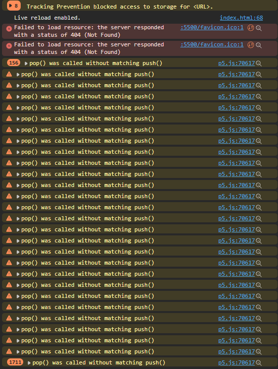
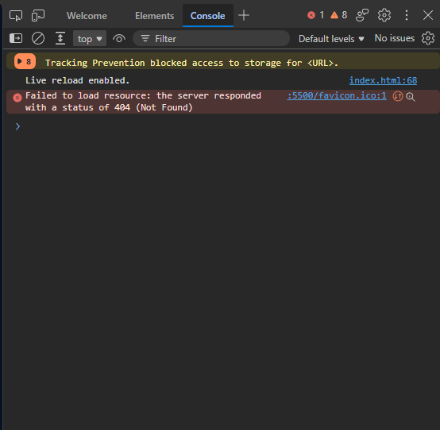

# Debugging Report - Bouncing Orbs

While testing my game and after the peer review I found a few bugs. In this report I explain for every bug what happens, how I can make it happen again, what the cause is and how I fixed it.

Bugs in this report:

1. Console error because of `pop()` without `push()`
2. The player can leave the canvas
3. The player does not go back to the start position
4. The ball spawn rate stays the same after a harder level
5. Shrink Player makes the player too small afterwards
6. Too many collision checks every frame

---

## Bug 1: Console error because of `pop()` without `push()`

**What happens:**
When I die, the browser console shows an error/warning about `push()` and `pop()`. Stein also saw console errors in his peer review.

**How to reproduce:**
1. Open the game with the browser console open (F12).
2. Start a level and die.
3. Look at the console while the death screen is shown.

**Expected:** No messages in the console.

**Actual:** A message about `pop()` is shown over and over while the death screen is open.



**Cause:**
In `deathScreen()` I call `pop()` before `push()`. The `pop()` has no `push()` before it, so every frame it tries to restore a drawing style that was never saved.

**Solution:**
I removed the extra `pop()`.

Before:

```js
  resetBallsTitle.removeClass(
    "abilityActive"
  );
  pop()
  push();
```

After:

```js
  resetBallsTitle.removeClass(
    "abilityActive"
  );
  push();
```

**Result:**


---

## Bug 2: The player does not go back to the start position

**What happens:**
After I die and start a new level, the player starts at the place where I died. Sometimes it starts right next to a ball.

**How to reproduce:**
1. Start a level and move the player to the middle of the canvas.
2. Press `C` to end the game.
3. Press the spacebar and start a level again.
4. The player is still in the middle of the canvas.

**Expected:** The player starts in the top left corner every time.

**Actual:** The player starts where I died.

**Cause:**
`playerX` and `playerY` are only set once at the top of the file. `resetBalls()` does not set them back.

**Solution:**
I added constants for the start position and set the player back in `resetBalls()`.

```js
const PLAYER_START_X = 10;
const PLAYER_START_Y = 10;

let playerX = PLAYER_START_X;
let playerY = PLAYER_START_Y;
```

```js
function resetBalls(balls) {
  // ...
  playerX = PLAYER_START_X;
  playerY = PLAYER_START_Y;
  // ...
}
```

**Result:**
The player now always start at the top left.

---

## Bug 3: The ball spawn rate stays the same after a harder level

**What happens:**
When I play Level 3 first and then Level 1, Level 1 is much harder than it should be, because balls appear very fast.

**How to reproduce:**
1. Start Level 3 and die (or press `C`).
2. Go back to the menu and start Level 1.
3. Watch the ball counter. New balls appear as fast as in Level 3.

**Expected:** Level 1 has the slowest ball spawning.

**Actual:** Level 1 uses the spawn rate of the level I played before.

**Cause:**
In `controlTimerAbilitys()` I only set `ballSpawnRate` for Level 2 and Level 3. For Level 1 it is never set, so it keeps the value of the last level.

**Solution:**
I set the spawn rate for Level 1 too.

```js
if (gameState === "lvl1") {
  ballSpawnRate = 10;
}
```

**Result:**
The ballSpawnRate is now fixed to 10. Which makes level 1 easier.

---

## Bug 5: Shrink Player makes the player too small afterwards

**What happens:**
After the Shrink Player ability ends, the player stays smaller than it was before.

**How to reproduce:**
1. Play Level 2 or Level 3 until Shrink Player appears.
2. Wait until the ability is over (5 seconds).
3. Compare the size of the player with the size at the start of the game.

**Expected:** The player goes back to the normal size (10).

**Actual:** The player is half the normal size (5).

**Cause:**
At the end of the ability I set `playerSize = 5`, but the normal size at the start is `10`.

**Solution:**
I changed the value to the normal size.

Before:

```js
playerSize = 5;
```

After:

```js
playerSize = 10;
```

**Result:**
The size is now 10 after the ability is over.

